# RecipeClub user guide

A step-by-step tour of the Recipe Sharing Platform ("RecipeClub"). Every screenshot
was taken from the running application, signed in as the demo cook **Aarav Mehta**
with the [demo seed data](../seed/README.md) loaded.

> **Try it yourself:** start the app (see the [README](../README.md#running-locally)), then sign
> in with any account from [seed/ACCOUNTS.md](../seed/ACCOUNTS.md).

## Contents

1. [Features at a glance](#features-at-a-glance)
2. [Create an account](#1-create-an-account)
3. [Sign in](#2-sign-in)
4. [Home](#3-home)
5. [Browse, search and sort recipes](#4-browse-search-and-sort-recipes)
6. [Read reviews without leaving the list](#5-read-reviews-without-leaving-the-list)
7. [Open a recipe](#6-open-a-recipe)
8. [Rate and review a recipe](#7-rate-and-review-a-recipe)
9. [Share your own recipe](#8-share-your-own-recipe)
10. [Edit or delete your recipes and reviews](#9-edit-or-delete-your-recipes-and-reviews)
11. [Meet the community](#10-meet-the-community)
12. [Your profile](#11-your-profile)
13. [Edit your profile](#12-edit-your-profile)
14. [Log out or deactivate your account](#13-log-out-or-deactivate-your-account)
15. [Using it on a phone](#14-using-it-on-a-phone)
16. [Troubleshooting](#troubleshooting)

---

## Features at a glance

| Area | What you can do |
|---|---|
| **Accounts** | Register with live password-strength feedback, sign in, edit your profile, log out, deactivate your account |
| **Discover** | Browse every recipe as a photo card, search by name or description, sort by *Newest*, *Top rated*, *Quickest* or *Lightest*, filter to *My recipes* |
| **Recipes** | See cook time, calories, date added, community score and author; tick off ingredients as you cook; read every review |
| **Share** | Post a recipe in four guided steps with a live preview card, a completion ring, cook-time presets, ingredient rows and drag-and-drop photo upload |
| **Rate** | Score any recipe out of 10 with a star picker (mouse or keyboard), add a comment or quick notes, edit or delete your review later |
| **Community** | Browse all members, see who is signed in, open anyone's profile with their recipes and reviews |
| **Experience** | Dark "Saffron Noir" theme, animated page transitions, skeleton loading states, friendly empty and error states, themed confirmation dialogs, toast notifications, fully responsive from phone to desktop, honours *reduce motion* settings |

---

## 1. Create an account

Open the app and choose **Create account** in the top bar (or **Register now** on the sign-in card).

1. Enter your **full name** (3+ characters) and **email address**.
2. Choose a **password**. The strength meter and checklist update as you type. A password
   must have **8+ characters, a number, a special character (`@#$%^&+=`) and no spaces**,
   the same rules the server enforces.
3. Press **Create account**. You'll see a confirmation and land on the sign-in page.

*Here the password is still missing a special character, so the meter shows "Almost".*

---

## 2. Sign in

1. Enter your **email** and **password**. The labels float up as you type.
2. Press **Sign in**. The button shows a spinner, then *Welcome in*, and you're taken to Home.
3. A wrong email or password shakes the card and shows *Invalid email or password*.

Use the eye icon to show or hide your password.

---

## 3. Home

Home greets you by name and shows what the community is up to.

- **Hero:** rotating food photography with a progress bar for each slide. Click a bar to jump to that photo.
- **Live counters:** total recipes shared, ratings given and home cooks.
- **Shortcuts:** **Explore recipes** and **Share a recipe**.

Scroll down for **Trending now**, the three best-rated recipes, followed by a short
*How it works* section and a call to post your own recipe.

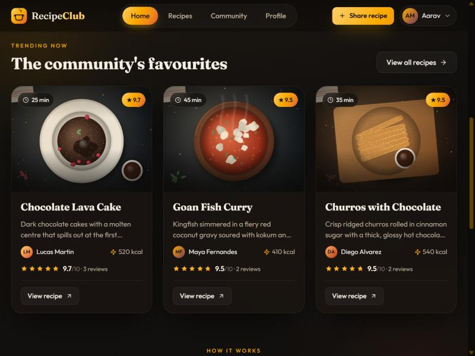

> The top bar is always available: **Home**, **Recipes**, **Community**, **Profile**,
> the **Share recipe** button and your account menu.

---

## 4. Browse, search and sort recipes

Choose **Recipes** in the top bar.

Each card shows the photo, cook time, community score (or *New* if unrated), title,
description, author, calories and star rating. Hover a card to zoom the photo and reveal
the open button; click the title or the arrow to open the recipe.

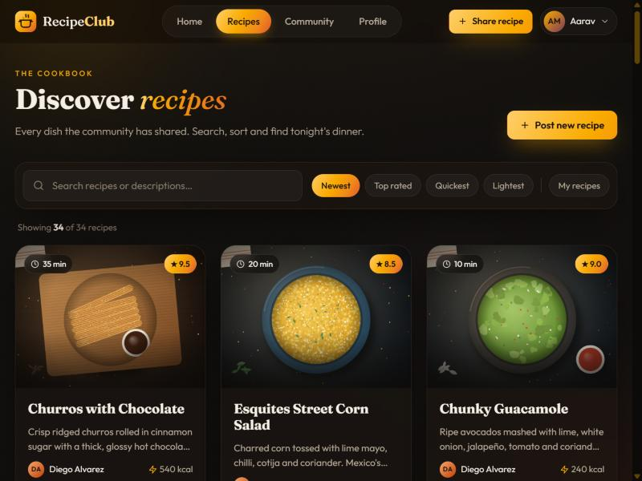

**Find something specific:**

1. Type in the **search box**. Results filter instantly by name *and* description.
   Clear it with the **×**.
2. Pick a **sort**: *Newest*, *Top rated*, *Quickest* (shortest cook time) or *Lightest* (fewest calories).
3. Toggle **My recipes** to see only what you've posted.

The line above the grid tells you how many recipes match.

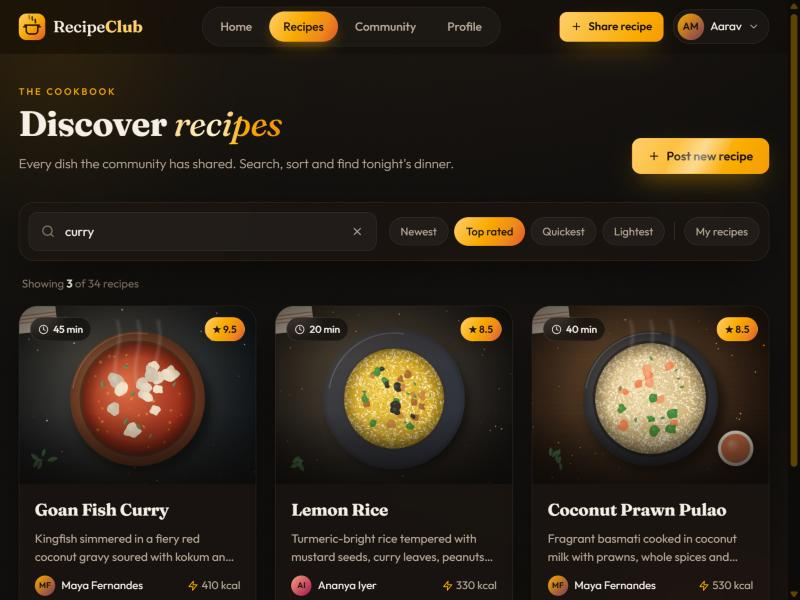

---

## 5. Read reviews without leaving the list

Press **Reviews** on any card to open a panel from the right with every rating and comment.

- Your own review is highlighted and has **Edit** and **Delete** buttons.
- **Add your rating** takes you straight to the rating page.
- Close it with **×**, by clicking outside, or with **Esc**.

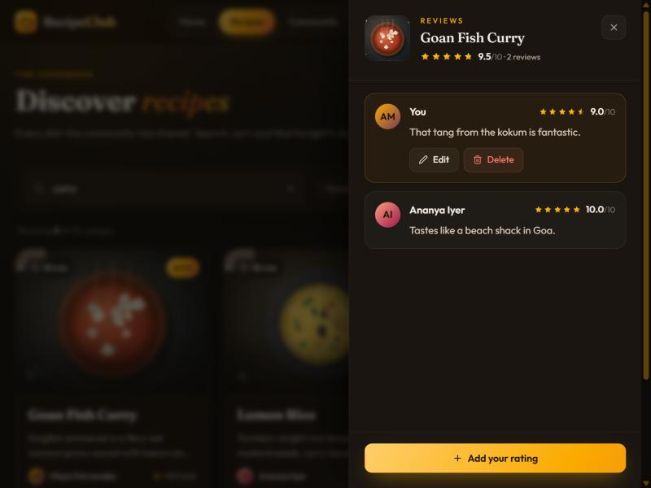

---

## 6. Open a recipe

The recipe page brings everything together:

- A large photo with the **community score**.
- The **author**; click their name to open their profile.
- Stat tiles for **cook time**, **calories**, **date added** and **rating**.
- **Rate this recipe**, plus **Edit recipe** if it's yours.

Scroll down for:

- **Ingredients:** tap each one as you prepare it. It's crossed out and the progress bar fills up.
- **Reviews:** everything the community said about the dish.

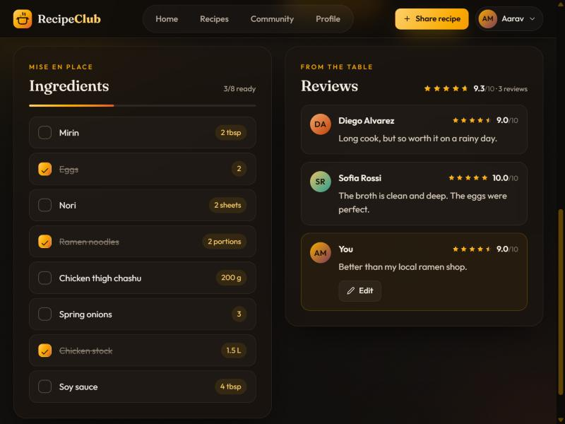

---

## 7. Rate and review a recipe

From a recipe page choose **Rate this recipe** (or **Add your rating** in the reviews panel).

1. **Pick a score out of 10.** Hover to preview, click to choose. With the keyboard,
   focus the stars and use the arrow keys. A word describes the score
   (*Needs work* … *Delicious* … *Masterpiece*).
2. **Write a review** (optional, up to 500 characters). The quick-note chips add common phrases.
3. Press **Submit rating**. You'll return to the recipe with your review added.

---

## 8. Share your own recipe

Press **Share recipe** in the top bar. The form has four steps, and the panel on the right shows a
**completion ring** and a **live preview** of your recipe card as you type.

**Step 1 – The basics:** recipe name (3+ characters) and a short description (up to 240 characters).

**Step 2 – Time & nutrition:** set the hours and minutes or tap a preset (*15 min*, *30 min*,
*45 min*, *1 hr*, *1 hr 30*), then enter calories per serving.

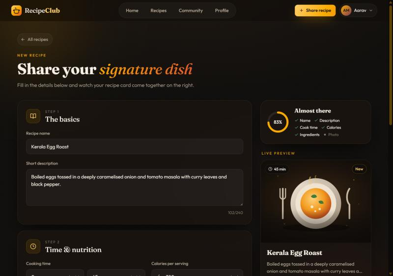

**Step 3 – Ingredients:** each row has a name and a quantity. Press **Add ingredient**, or
press **Enter** in the last quantity box to add a row; use the bin icon to remove one.

**Step 4 – Photo:** drag a PNG or JPEG (up to 10 MB) onto the drop area, or click it to browse.
The photo is optional. Recipes without one get an illustrated placeholder.

Press **Publish recipe**. If anything is missing, the form points to it; otherwise you're taken
to your new recipe page.

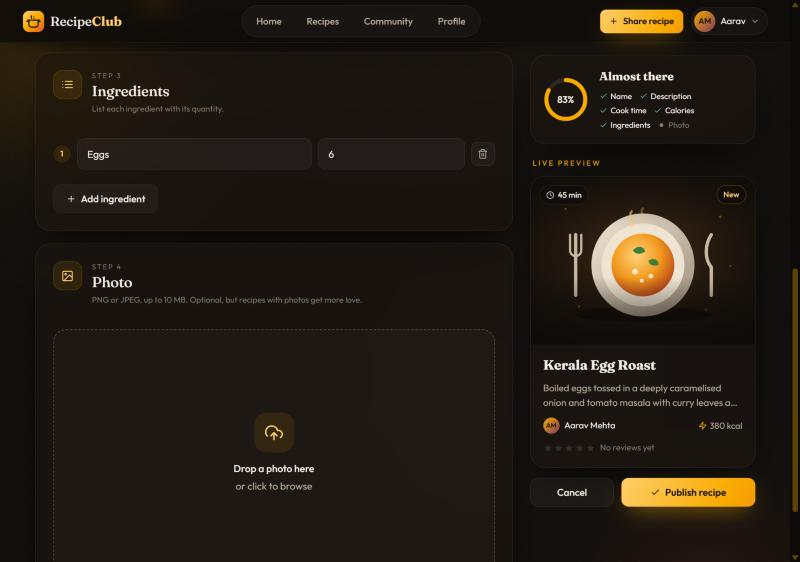

---

## 9. Edit or delete your recipes and reviews

| To… | Do this |
|---|---|
| Edit a recipe | Open it and press **Edit recipe**, or use the pencil icon on its card. The same four-step form opens with everything filled in, including the cook time. Choose a new photo only if you want to replace it. |
| Delete a recipe | Press the bin icon on its card in **Recipes**, then confirm. |
| Edit a review | Press **Edit** on your review (in the reviews panel, on the recipe page or on your profile). |
| Delete a review | Press **Delete** on your review in the reviews panel, then confirm. |

Every delete asks for confirmation first.

---

## 10. Meet the community

Choose **Community** in the top bar to see every member. A green dot means they're signed in
right now, and your own card is marked **You**. Search by name or email, then press
**View profile** to see what someone has cooked and rated.

---

## 11. Your profile

Choose **Profile** in the top bar (or **My profile** in the account menu).

- **Stats:** recipes shared, reviews written and your average score given.
- **Recipes tab:** everything you've posted; click a card to open it.
- **Reviews tab:** every review you've written, with a link to the recipe and an **Edit** button.
- **Edit profile** and **New recipe** shortcuts.

Other members' profiles look the same, without the editing buttons.

---

## 12. Edit your profile

From your profile press **Edit profile**. Change your **name**, **email** or **password**;
the avatar and preview update as you type. Press **Save changes** to return to your profile.
Your name in the top bar updates straight away.

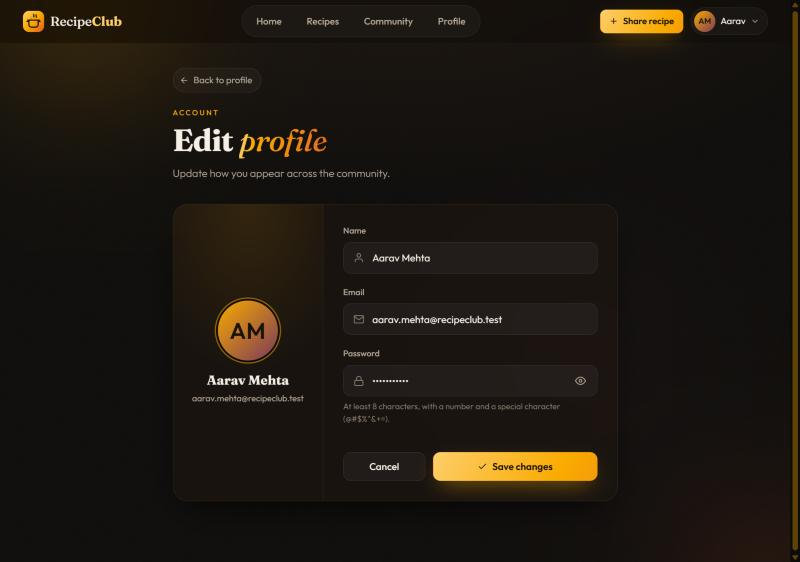

---

## 13. Log out or deactivate your account

Click your avatar in the top-right corner to open the **account menu**:

- **My profile**
- **Log out**
- **Deactivate account**, which permanently deletes your account

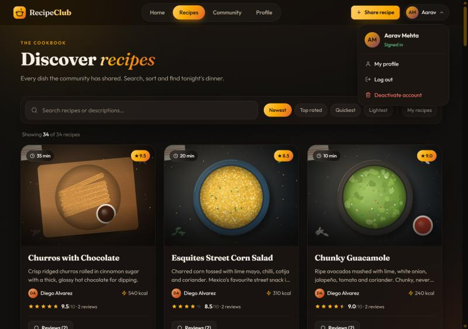

Both **Log out** and **Deactivate account** ask you to confirm in a dialog. Press **Cancel**
or **Esc** to back out.

---

## 14. Using it on a phone

The whole app adapts to small screens: the navigation collapses into a menu, cards stack
into one column, sort chips scroll sideways and forms become single-column.

| Home | Menu | Recipes |
|---|---|---|
| 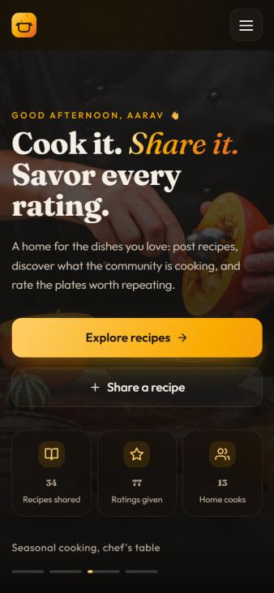 | 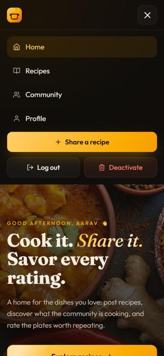 | 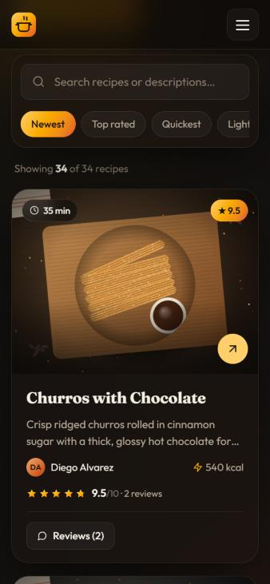 |

Tap the **☰** button to open the menu; it holds every page plus **Share a recipe**,
**Log out** and **Deactivate**.

To open the app on a phone on the same Wi-Fi, see
[Opening the app on another device](../README.md#opening-the-app-on-another-device).

---

## Troubleshooting

| Problem | What to check |
|---|---|
| *Couldn't load recipes* / *Couldn't load the community* | The backend services aren't reachable. Make sure the registry, gateway and the user, recipe and rating services are running, then press **Try again**. |
| Can't create an account | Check the password rules in the checklist. If the email is already registered, sign in instead. |
| *Invalid email or password* | Check the email address, and use the eye icon to check the password you typed. |
| Photo won't upload | Use a PNG or JPEG under 10 MB. A file name that already exists on the server can also fail; rename the file and try again. |
| Animations feel too busy | Turn on *Reduce motion* in your operating system; the app switches its animations off. |
